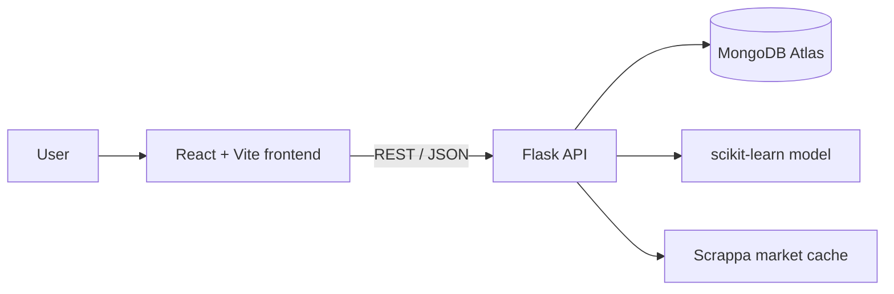

# Gurugram Real Estate Analyzer

An end-to-end real-estate analytics dashboard for exploring Gurugram property data, managing listings in MongoDB Atlas, comparing properties, and estimating prices with a saved machine-learning pipeline.

## Features

- Dashboard with property counts, market statistics, top listings, and quick navigation
- Searchable and filterable property management with create, edit, detail, and delete flows
- Price prediction powered by a saved scikit-learn pipeline
- Analytics for prices, localities, property types, and comparisons
- MongoDB Insights for indexes, coverage, aggregation, and query performance
- Optional Scrappa-backed market comparison with MongoDB caching
- Reproducible model evaluation and group-level coverage reports

## Architecture



## Tech stack

- **Frontend:** React, TypeScript, Vite, Tailwind CSS, Lucide React
- **Backend:** Python, Flask, Flask-CORS, PyMongo
- **Database:** MongoDB Atlas
- **Machine learning:** scikit-learn, pandas, NumPy, joblib
- **Data:** Gurugram real-estate CSV files and MongoDB property documents

## Project structure

```text
.
├── App.tsx                       # Frontend shell and navigation
├── components/                   # Reusable React components
├── views/                        # Dashboard feature views
├── lib/database.ts               # Frontend API client
├── lib/ml.ts                     # Browser-side model utilities
├── backend/app.py                # Flask routes
├── backend/db.py                 # MongoDB connection and indexes
├── backend/model_service.py      # Model loading and prediction
├── backend/model_evaluation.py   # Evaluation workflow
├── data/                         # Local datasets
├── models/                       # Model artifacts and metrics
├── test_aggregation.py           # Aggregation smoke test
└── requirements.txt              # Python dependencies
```

## Requirements

- Python 3.10+
- Node.js 18+
- pnpm or npm
- MongoDB Atlas connection string

## Local setup

### 1. Configure Python

```powershell
py -m venv .venv
.\.venv\Scripts\Activate.ps1
pip install -r requirements.txt
```

### 2. Configure environment variables

Copy the template:

```powershell
Copy-Item .env.example .env
```

Set at least `MONGODB_URI` in `.env`. The main variables are:

| Variable | Purpose |
| --- | --- |
| `MONGODB_URI` | MongoDB Atlas connection string |
| `MONGODB_DATABASE` | Database name; defaults to `gurugram_real_estate` |
| `MONGODB_COLLECTION` | Collection name; defaults to `properties` |
| `MODEL_PATH` | Saved model path |
| `FRONTEND_ORIGIN` | Frontend origin allowed by CORS |
| `SCRAPPA_API_KEY` | Optional market-data API token |
| `SCRAPPA_CITY` | Market-data city; defaults to `Gurgaon` |

Never commit `.env` or expose credentials in frontend code.

### 3. Start the backend

From the repository root:

```powershell
python -m backend.app
```

Flask runs at `http://localhost:5000`.

### 4. Start the frontend

In a second terminal:

```powershell
pnpm install
pnpm dev
```

Open the Vite URL, normally `http://localhost:5173`.

The frontend defaults to `http://localhost:5000`. To change it, add this to the frontend environment:

```env
VITE_API_BASE_URL=http://localhost:5000
```

## API reference

All endpoints are prefixed with `/api`.

| Method | Endpoint | Description |
| --- | --- | --- |
| GET | `/health` | Check API and database availability |
| GET | `/properties` | Paginated, searchable property list |
| GET | `/properties/<id>` | Get one property |
| POST | `/properties` | Create a property |
| PUT | `/properties/<id>` | Update a property |
| DELETE | `/properties/<id>` | Delete a property |
| GET | `/property-filters` | Get filter values |
| GET | `/prediction-options` | Get prediction form options |
| POST | `/predict` | Generate a price prediction |
| POST | `/market-comparison` | Compare prediction with market data |
| GET | `/model-metrics` | Get model metrics |
| GET | `/group-evaluation` | Get grouped evaluation results |
| GET | `/dashboard` | Get dashboard aggregates |
| GET | `/insights` | Get MongoDB and data-quality insights |

Health check:

```powershell
Invoke-RestMethod http://localhost:5000/api/health
```

## Machine-learning workflow

The production prediction endpoint loads `models/gurugram_price_model.joblib` by default. It uses numerical and categorical property features and supports unknown categories through `OneHotEncoder(handle_unknown="ignore")`.

Generate reproducible reference metrics with:

```powershell
.\.venv\Scripts\python.exe -m backend.model_evaluation
```

This uses an 80/20 split with `random_state=42` and writes evaluation artifacts to `models/`. It does not automatically replace the production model.

The frontend also includes educational Linear Regression, Decision Tree, Random Forest, and Gradient Boosting utilities in `lib/ml.ts`.

## Data and validation

- Core fields include `Price`, `Area`, `Rate per sqft`, `Locality`, `Flat Type`, `BHK_Count`, and `RERA Approval`.
- Manual writes validate required fields and enforce `Price = Area × Rate per sqft`.
- Analytics and coverage reports are read-only.
- Prediction quality depends on the number of records representing the selected locality, property type, and BHK.
- Predictions are estimates, not valuations or financial guarantees.

## Development commands

```powershell
pnpm dev
pnpm build
pnpm preview
pytest test_aggregation.py
```

## Troubleshooting

**MongoDB unavailable:** Check `MONGODB_URI`, Atlas network access rules, and database-user permissions.

**Frontend cannot reach Flask:** Confirm Flask is running on port 5000, or update `VITE_API_BASE_URL` and restart Vite.

**Model loading fails:** Confirm `MODEL_PATH` points to a valid `.joblib` file and reinstall the pinned dependencies.

**Limited prediction coverage:** Use MongoDB Insights and group evaluation to inspect the available records for the selected inputs.

## Security

- Keep MongoDB credentials and API keys private.
- Do not enable Flask debug mode in production.
- Restrict Atlas network access and database permissions.
- Add authentication and authorization before exposing write endpoints publicly.

## License

No license has been declared yet. Add a `LICENSE` file before distributing the project.

## Acknowledgements

This README follows the structured documentation style of the referenced [PetroSentinel AI repository](https://github.com/peeyush521/Sih-oil7), while documenting this Gurugram Real Estate Analyzer according to its actual implementation.
